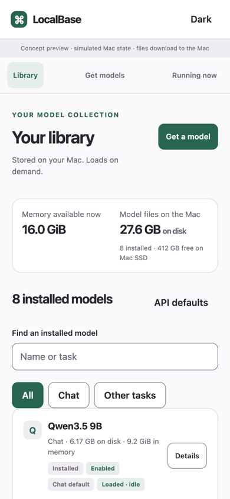
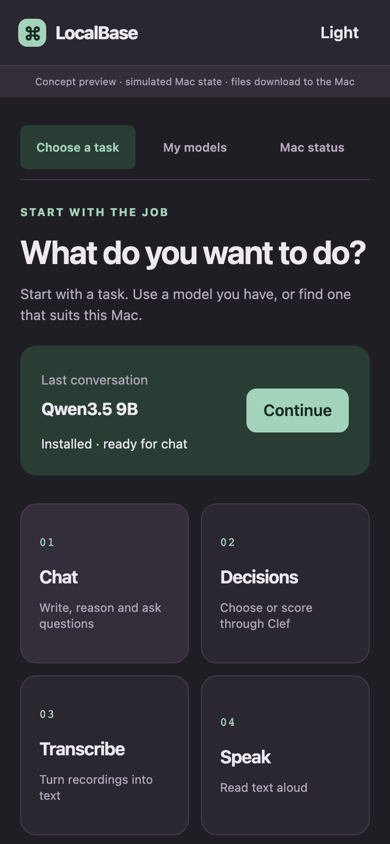
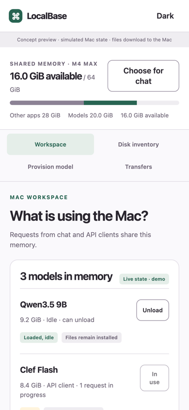
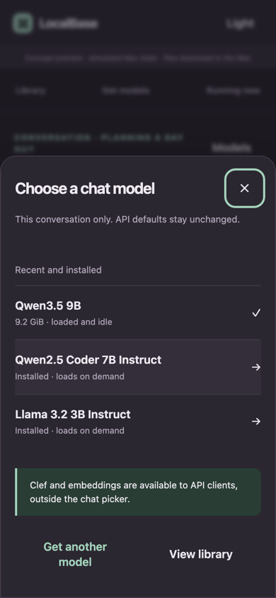
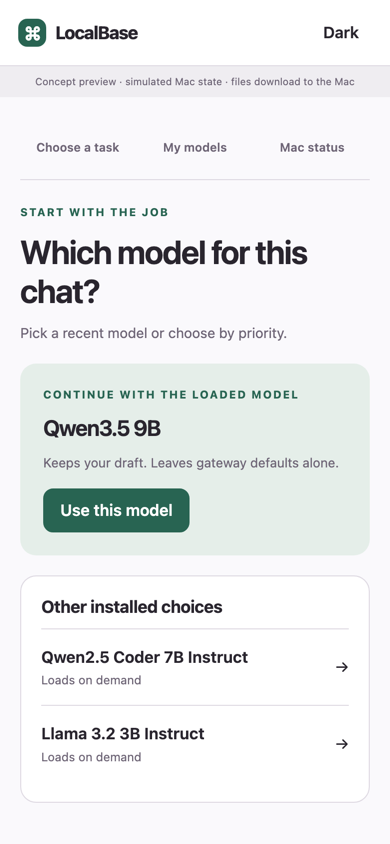
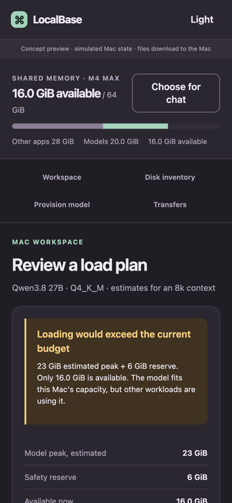

# Pick the structure first

Round 3 explores three different ways to organize model selection. These are standalone clickable concepts, with real LocalBase catalog data and simulated Mac state. No application changes and no PR.

| Shelf | Compass | Control room |
| --- | --- | --- |
|  |  |  |
|  |  |  |

Tap a screenshot to read it full size. [All states and themes](screenshots/INDEX.md) · [Interactive review gallery](index.html)

**Shelf.** Library / Get models / Running now. Choose a recent chat model in a small sheet; inspect installed files and running workloads separately. Discovery groups files under one model, with the qualified choice first. Best match for daily switching and weekly maintenance. [Prototype](concepts/shelf/index.html)

**Compass.** Start with “What do you want to do?” Task → priority → recommendation → file. Recent models bypass the guide; people who know a name can search directly. Best at explaining unfamiliar capabilities, but an occasional setup job gets the main stage. [Prototype](concepts/compass/index.html)

**Control room.** Start with the shared Mac. Running work, disk inventory, provisioning and transfers are distinct destinations. Selection shows current memory and a proposed load before changing anything. Strongest for contention and API workloads; heaviest for a quick phone chat. [Prototype](concepts/control/index.html)

I recommend **Shelf**, with Compass's guided entrance inside Get models and Control room's explanation inside a memory warning. This keeps the frequent jobs direct while making occasional decisions understandable. Do not merge all three navigation systems.

The user-proposed frequencies remain hypotheses. First compare four tasks: switch a conversation without losing its draft; add Qwen3.8 without knowing quantization; explain what's in memory; reclaim disk without breaking defaults.

Research covered LM Studio, Ollama, Hugging Face, Docker Desktop and Apple Storage. The catalog-pinned Qwen3.8 repository has 26 standalone weight variants, plus a two-shard bf16 set and supplementary files. The prototypes expose ten common choices and the rest on disclosure. Pinned Q4_K_M is 17.77 GB. File size, memory estimates and qualification stay separate.

[Evidence, jobs and accessibility tests](BRIEF.md) · [IA, journeys, risks](CONCEPTS.md) · [Implementation plan](IMPLEMENTATION.md) · [Checks and limits](VERIFICATION.md)

## Open the clickable versions

GitHub displays the HTML source. Download or clone this branch and open each concept's index.html directly, or run `bun .design/research/model-selection-v3/serve.mjs` in the worktree and visit `http://127.0.0.1:24082/`. No packages, model loads or gateway connection needed. Each concept HTML embeds its own CSS, JavaScript and catalog data. The gallery uses local screenshots.

Skill process: ux-research steps 1–7 and local-ui critique/design steps 1–5. Both skills were read in full; step-by-step evidence is in BRIEF.md. Browser checks cover layout and selected interactions, not full accessibility conformance or real transfer durability.
