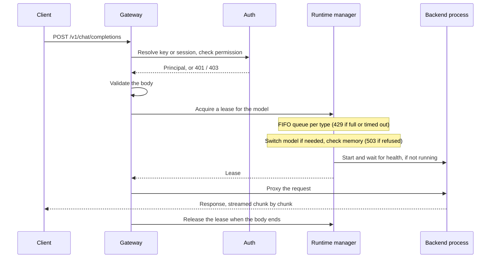

# Development overview

LocalBase is one Go binary: the OpenAI-compatible API, the admin API, the server-rendered UI and the CLI. It runs each model in a separate backend process, such as `llama-server`, and proxies to it. [`go/DESIGN.md`](go/DESIGN.md) is the detailed design and history.

## Repo map

| Path | What it is |
| --- | --- |
| `go/cmd/localbase/` | CLI entry point and one file per command. `serve.go` wires everything |
| `go/internal/gateway/` | HTTP router, OpenAI and admin handlers, detached runs |
| `go/internal/web/` | UI: Go templates, htmx, small JavaScript files, compiled Tailwind CSS |
| `go/internal/runtime/` | Launch plans, process supervision, per-type queues, runtime downloads |
| `go/internal/memory/` | Host memory readings, estimates and admission |
| `go/internal/placement/` | CPU and GPU placement planner |
| `go/internal/catalog/` | Built-in catalog, user entries and the remote feed |
| `go/internal/hub/`, `acquire/`, `install/` | Hugging Face discovery and downloads |
| `go/internal/auth/` | API keys, browser sessions, OIDC, Cloudflare Access, policy |
| `go/internal/store/` | SQLite, migrations (the drizzle-format SQL both versions read) and typed queries |
| `go/internal/root/` | Data directory, marker and the gateway lock |
| `go/internal/service/` | launchd and systemd user units |
| `go/internal/obs/`, `otlp/` | Logs, redaction and OTLP export |
| `go/test/contract/` | Black-box HTTP contract suite |
| `go/tools/` | Check scripts and test tools |
| `docs/` | User documentation |
| `scripts/release/`, `packaging/` | Go release build, installer test, Homebrew template |
| `src/`, most of `scripts/` | Legacy TypeScript version and what it needs. See below |

## Life of a request

## Rules worth knowing

- **Few dependencies.** The only Go module the code imports directly is `modernc.org/sqlite`. There's no HTTP router, CLI framework or ORM, so every addition needs a reason.
- **No cgo.** `CGO_ENABLED=0` gives a static binary that cross-compiles.
- **One active model per type.** Requests change the model, in FIFO order.
- **Dependencies run one way:** `gateway, web → runtime → memory → catalog → store → root`, and `gateway, web → auth → store`.
- **Secrets and content stay out of logs.** The log handler redacts attributes whose names contain words like `input`, `output`, `prompt` and `content`. Test new log events through `obs.NewHandler`.
- **Detached runs** are the one place model output reaches disk (`<root>/runs/`), and that's deliberate and short-lived.

## The legacy TypeScript tree

`src/` is the version Go replaced. It stays as a rollback path, and the golden test data was recorded from it. The catalog's source is `go/internal/catalog/data`; `cd go && go run ./tools/catalog-feed` writes `catalog/feed.json` and `catalog/feed-v2.json` from it. The managed runtime manifest's home is `go/internal/runtime/managed-runtime-manifest.json`; the sync workflows also write the identical copy in `src/manager/`, which the runtime release helpers read until they move, and a test fails if the two differ. See the retirement plan in `docs/typescript-retirement.md`.

## CI

| Workflow | Runs |
| --- | --- |
| `go.yml` | Format, vet, race tests (internal/backup in shards), CSS check, the contract and system suites, and the page-script and Bun script tests, as parallel jobs on Linux and macOS; `go-checks` passes only when all of them do |
| `repo-guards.yml` | Binaries, large files, action pins, permissions and secrets scan |
| `go-lint.yml` | golangci-lint with `go/.golangci.yml` |
| `contributor-setup.yml` | `make bootstrap`, `check`, `ui`, `lint` and `build` from a fresh Linux checkout, when the setup changes |
| `soak.yml` | One soak cycle nightly on Linux and macOS, and the 30-minute soak plus a race-detector cycle weekly |
| `release-go.yml` | Release build, installer test on four platforms. Publishes a draft on tags only |
